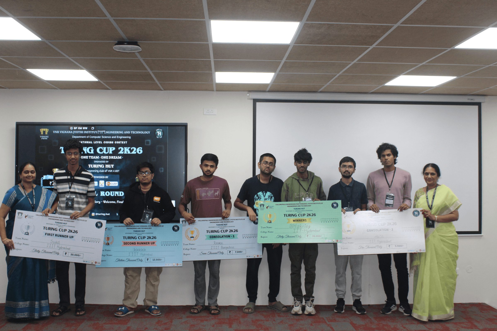
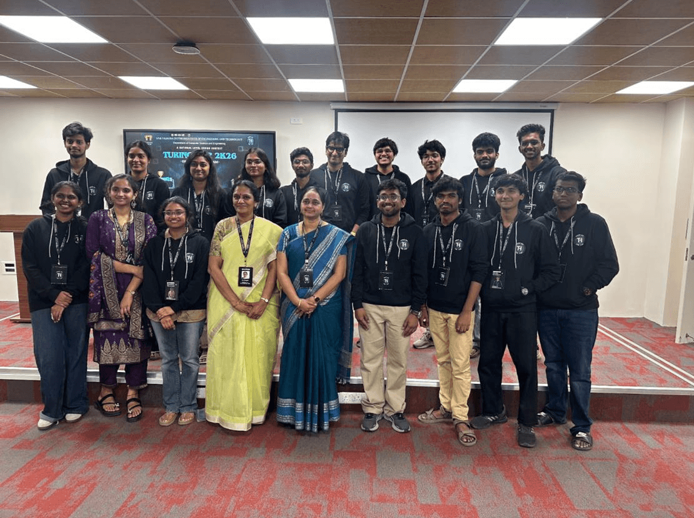
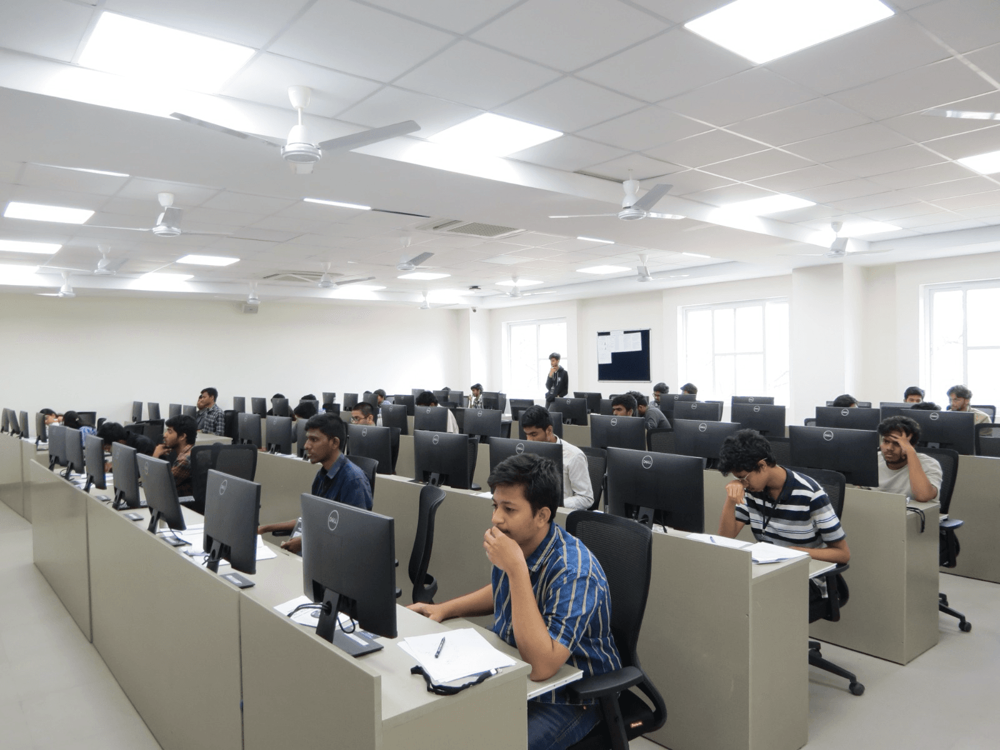
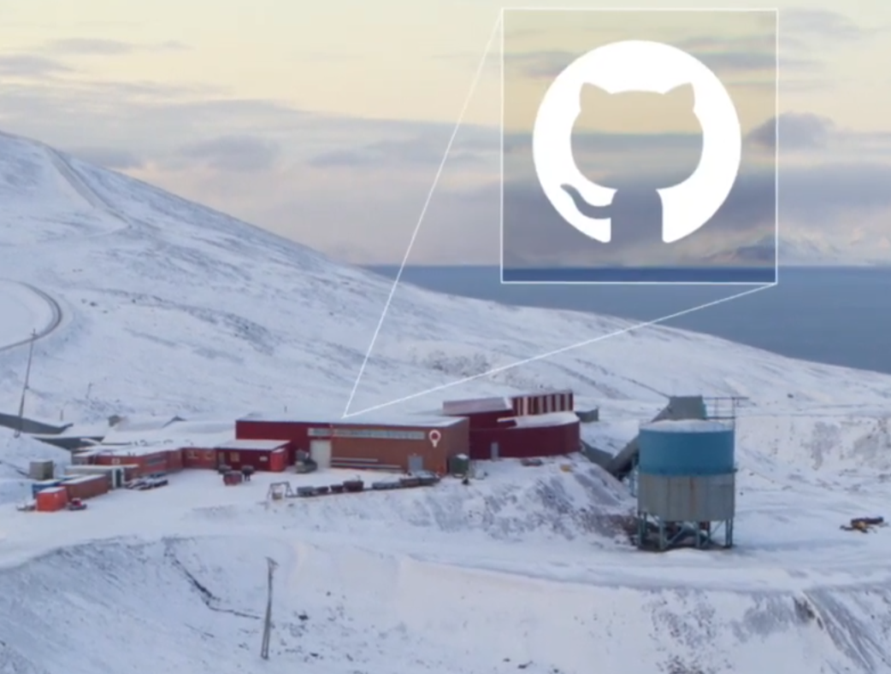
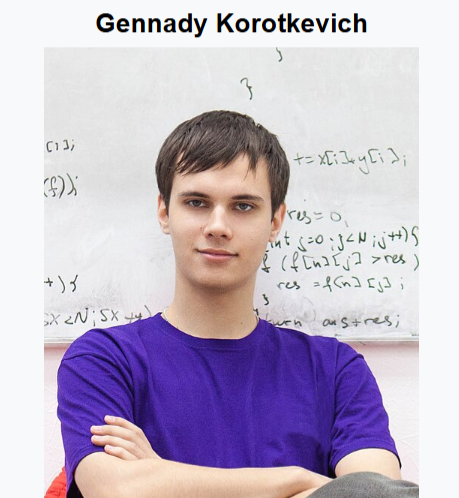

Greetings Readers,

The excitement continued in 2026 with the successful conduct of **Turing Cup 2K26**, Turing Hut’s flagship competitive coding contest, organized by the official Competitive Programming Club of **VNR Vignana Jyothi Institute of Engineering and Technology**. The contest brought together passionate coders from across leading institutions, creating an intense atmosphere of competition, problem-solving, and learning.

---

<h1>Highlights</h1>

<h2 style="text-align:center; margin-top:20px;">Turing Cup 2K26 – One Team. One Dream</h2>

<table class="nl-highlight-table">
<tr>
<td colspan="2" style="text-align:center;">

</td>
</tr>
<tr>
<td style="width:50%; vertical-align:top;">

</td>
<td style="width:50%; vertical-align:top;">

</td>
</tr>
</table>

The flagship national-level coding contest of Turing Hut, <strong>Turing Cup 2K26</strong>, brought together <strong>1667 teams from 365 colleges</strong> across India, with participation spanning <strong>23 states</strong> and international representation from <strong>Bangladesh</strong>.

<ul style="line-height:1.7; font-size:17px;">
  <li><strong>Online Qualifier:</strong> HackerRank (February 28, 2026)</li>
  <li><strong>Grand Finale:</strong> Codeforces at VNRVJIET (March 18, 2026)</li>
</ul>

The contest showcased unmatched competitive spirit, teamwork, and coding excellence, bringing together talented programmers from across the country in one of the year's most exciting competitive programming battles.

---

  

<h1>Game of Code Play</h1>

1. A scrambled word will be provided along with a hint from the world of coding
 
2. Read the hint carefully
 
3. Unscramble the letters to form the correct word

<h2 style="margin-top:25px;">
Your &lt;Time/&gt;; Starts Now
</h2>

a. <b>OLEBANO</b> → A data type that can only hold one of two possible values.
 
b. <b>RPECIMLO</b> → Translates your high-level source code into machine language.
 
c. <b>XATNYS</b> → The strict rules that dictate how a programming language must be written.
 
d. <b>MATORLIGH</b> → A step-by-step set of instructions used to solve a specific problem.
 
e. <b>GIDGEUBNG</b> → The tedious (but rewarding) process of finding and fixing errors in your code.

---

# Interesting Reads

<table style="width:100%;">
<tr>

<td style="width:50%; vertical-align:top; padding-right:25px;">

 

<b>The Arctic Code Vault</b>: In an effort to preserve open-source software for future generations, 21 terabytes of repository data were successfully deposited into the Arctic World Archive. This "code vault" is hidden 250 meters deep inside a permafrost mountain in Svalbard, Norway, designed to last for a thousand years...<a href="https://archiveprogram.github.com/arctic-vault/" target="_blank">read more</a>

</td>

<td style="width:50%; vertical-align:top; padding-left:25px;">

 

<b>The Undefeated Code Jam Champion</b>: Gennady Korotkevich, known online as <b>"tourist"</b>, is widely considered one of the greatest competitive programmers of all time. He holds the unprecedented record of winning the prestigious global Google Code Jam tournament for seven consecutive years, a streak that remained unbroken until the competition's retirement...<a href="https://en.wikipedia.org/wiki/Gennady_Korotkevich" target="_blank">read more</a>

</td>

</tr>
</table>
 

That wraps up our list of interesting reads. Now, it’s time to put your skills to work in the given problem section!

 

---

<h1 style="font-style:italic;">
ToDo Problem
</h1>

Here’s a great problem we think you’ll enjoy solving:
<a href="https://codeforces.com/problemset/problem/2242/D">problem link</a>.

Have any experiences, opportunities or articles to share?
Fill out this <a href="https://docs.google.com/forms/d/e/1FAIpQLSfdaR5IK8B9RZx-5G3cd4_G4RMsLIaHRMWpGWzTwMyuMdCeWg/viewform">form</a> to be featured in our next newsletter.

Thanks to Harshini(24071A05M6), Anirudh(24071A0556), Yogitha(24071A05G9), Kruthikha(24071A6729) and Jigna(24071A67G5) for contributing to the newsletter.

 

a. BOOLEAN &nbsp;&nbsp;
b. COMPILER &nbsp;&nbsp;
c. SYNTAX &nbsp;&nbsp;
d. ALGORITHM &nbsp;&nbsp;
e. DEBUGGING

