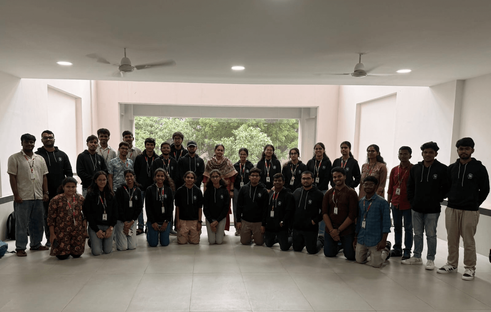
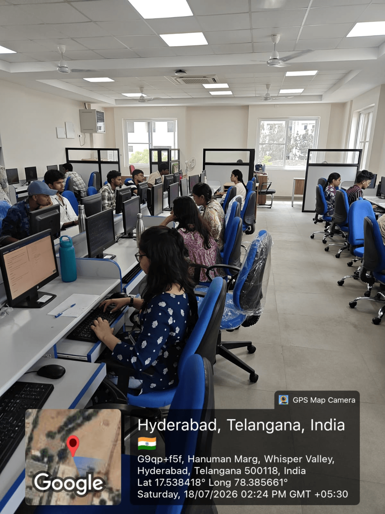
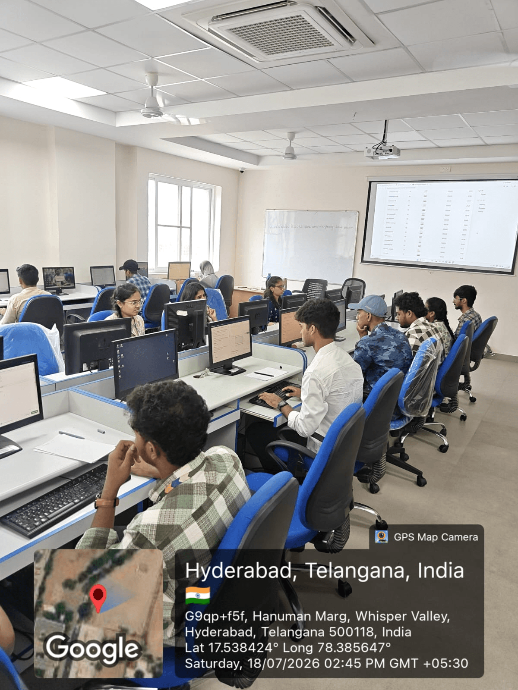
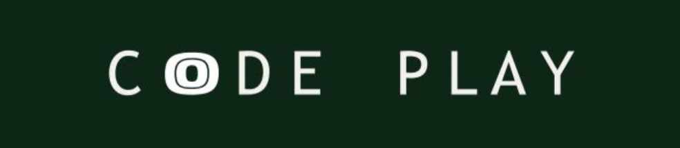
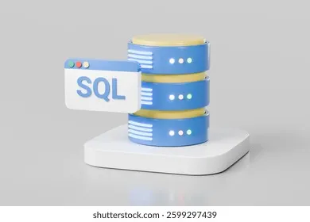
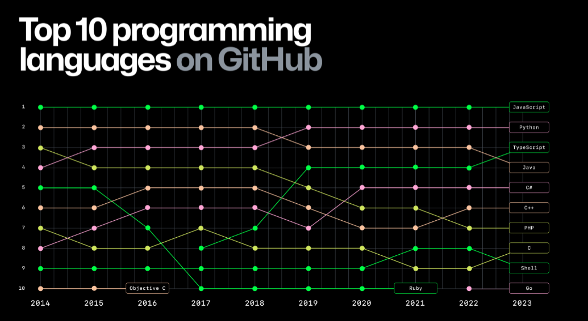

Greetings Readers,

The competitive spirit continued with **CodeFrenzy 2K26**, a coding contest conducted exclusively for second-year students by Turing Hut, the official Competitive Programming Club of **VNR Vignana Jyothi Institute of Engineering and Technology**. The event provided participants with an opportunity to challenge their coding and problem-solving skills, with the top performers earning a place in Turing Hut’s Peer-to-Peer Learning Sessions, fostering a culture of collaborative learning and competitive programming.

---

<h1>Highlights</h1>

<h2 style="text-align:center; margin-top:20px;">CodeFrenzy 2K26 – Selection Contest for 2nd Years</h2>

<table class="nl-highlight-table">
<tr>
<td colspan="2" style="text-align:center;">

</td>
</tr>
<tr>
<td style="width:50%; vertical-align:top;">

</td>
<td style="width:50%; vertical-align:top;">

</td>
</tr>
</table>

CodeFrenzy 2K26 brought together <strong>299 second-year students</strong> for an onsite coding contest held in the E-Block Labs on <strong>July 18, 2026</strong>. The contest featured 8 problems covering topics such as greedy algorithms, mathematical and logical reasoning, game theory, number theory, hashing, computational geometry, and combinatorics.

The event also served as a selection platform for Turing Hut’s <strong>Peer-to-Peer Competitive Programming Sessions</strong>, with <strong>79 students selected</strong> based on their contest performance, competitive programming experience, platform ratings, problems solved, and interest in CP.

---

  

<h1>Game of Code Play</h1>

1. A scrambled word will be provided along with a hint from the world of coding
 
2. Read the hint carefully
 
3. Unscramble the letters to form the correct word

<h2 style="margin-top:25px;">
Your &lt;Time/&gt;; Starts Now
</h2>

a. <b>ZIOMTAEMOIN</b> → Storing previously calculated results to avoid redundant work in top-down dynamic programming.
 
b. <b>EDEYRG</b> → An algorithmic paradigm that makes the locally optimal choice at each stage to find a global optimum.
 
c. <b>IRET</b> → A prefix tree data structure frequently used for fast string matching and XOR maximization.
 
d. <b>NIKCGARCKTAB</b> → An algorithmic technique that explores all possible solutions and abandons paths as soon as they fail constraints.
 
e. <b>TSIDJRAK</b> → A classic algorithm used to find the shortest path from a single source in a graph with non-negative edge weights.

---

# Interesting Reads

<table style="width:100%;">
<tr>

<td style="width:50%; vertical-align:top; padding-right:25px;">

 

<b>The Origin of "SEQUEL"</b>: The relational database language we use today was originally developed at IBM in the 1970s by Donald Chamberlin and Raymond Boyce. It was initially named SEQUEL (Structured English Query Language), but the name had to be shortened simply because a UK-based aircraft manufacturer already held the trademark for the word...<a href="https://en.wikipedia.org/wiki/SQL" target="_blank">read more</a>

</td>

<td style="width:50%; vertical-align:top; padding-left:25px;">

 

<b>Python Overtakes the Giants</b>: After years of JavaScript dominating developer ecosystems, Python officially became the most-used language on GitHub. This historic shift was largely driven by the massive surge in artificial intelligence, machine learning, and data science projects, alongside its heavy adoption in academic and competitive coding environments...<a href="https://github.blog/2023-11-08-the-state-of-open-source-and-ai/" target="_blank">read more</a>

</td>

</tr>
</table>
 

That wraps up our list of interesting reads. Now, it’s time to put your skills to work in the given problem section!

 

---

<h1 style="font-style:italic;">
ToDo Problem
</h1>

Here’s a great problem we think you’ll enjoy solving:
<a href="https://codeforces.com/problemset/problem/2241/D">problem link</a>.

Have any experiences, opportunities or articles to share?
Fill out this <a href="https://docs.google.com/forms/d/e/1FAIpQLSfdaR5IK8B9RZx-5G3cd4_G4RMsLIaHRMWpGWzTwMyuMdCeWg/viewform">form</a> to be featured in our next newsletter.

Thanks to Harshini(24071A05M6), Anirudh(24071A0556), Yogitha(24071A05G9), Kruthikha(24071A6729) and Jigna(24071A67G5) for contributing to the newsletter.

 

a. MEMOIZATION &nbsp;&nbsp;
b. GREEDY &nbsp;&nbsp;
c. TRIE &nbsp;&nbsp;
d. BACKTRACKING &nbsp;&nbsp;
e. DIJKSTRA

